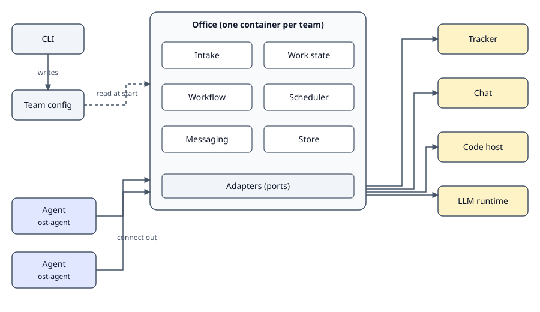

Outstaff has five kinds of component. The hosting of the containers and the storage of secrets are the client's choice; Outstaff defines a container contract and will ship guides.

## Components

**Catalog.** Generic roles and skills, baked into the container images. Clients can eject and customize them.

**Team config.** `.outstaff/team.yaml` in the client repository describes humans, people, repositories with read and write grants, integrations, workflow and policies. The CLI creates and updates it. Only the office loads it; agents receive it from the office when they connect.

**Office.** One container per team. It takes in events by polling or webhooks, keeps work state (tickets, pull requests, CI, reviews), decides what to do about each event (with the workflow engine, or the proposed [event pipeline](/concepts/automation/) when it is live), schedules work items for each agent, routes agent-to-agent questions through messaging, and stores state in Postgres or SQLite.

**Agent.** One container per person. `ost-agent` connects out to the office, so agents need no inbound network access. It runs work items through an LLM runtime adapter (the Claude Code CLI first), keeps a separate session, worktree and journal per work item, and gives the agent a small set of tracker-neutral `ost` verbs.

**Adapters.** Separate packages, one per integration, in `integrations/<port>/<vendor>` and named `@outstaff/integration.<port>.<vendor>`. Each implements a port and is checked by a shared contract test kit.

## Ports

| Port                 | Purpose                                                                          |
| -------------------- | -------------------------------------------------------------------------------- |
| Tracker (optional)   | Reads and updates tickets in the issue tracker.                                  |
| Knowledge (optional) | Reads and writes the team's documents and notes.                                 |
| Vcs                  | Works with the code host: repositories, branches, pull requests, CI and reviews. |
| Chat                 | Sends and receives messages in the team's chat workspace.                        |
| Runtime              | Runs an agent session on an LLM runtime.                                         |
| Avatars              | Provides profile images for people (generated or from a chosen source).          |

Adapter packages for each port will be documented under [Adapters](/adapters/).
